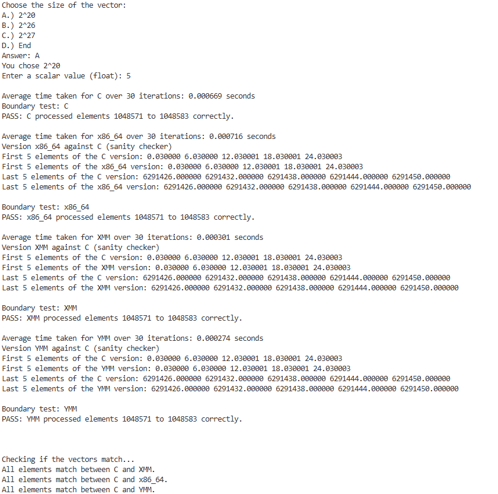
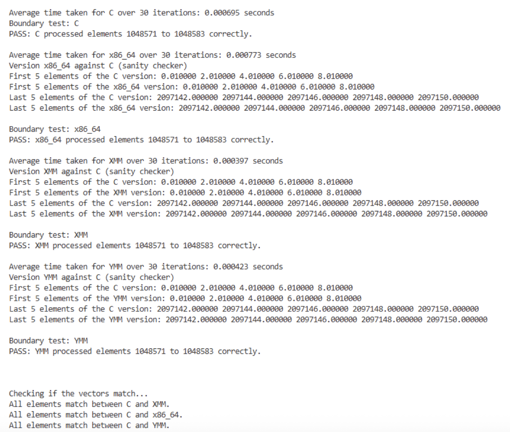
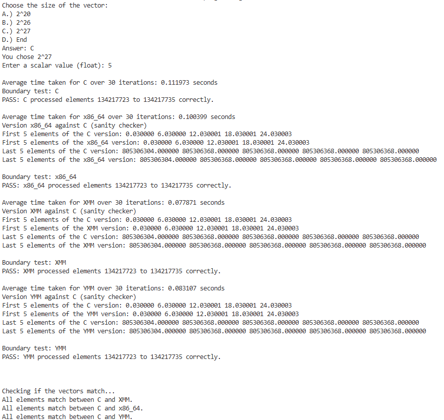
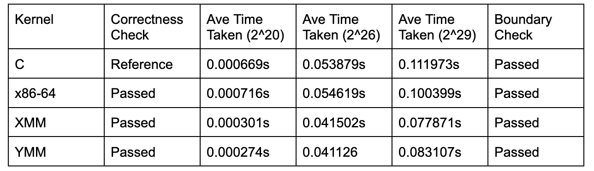
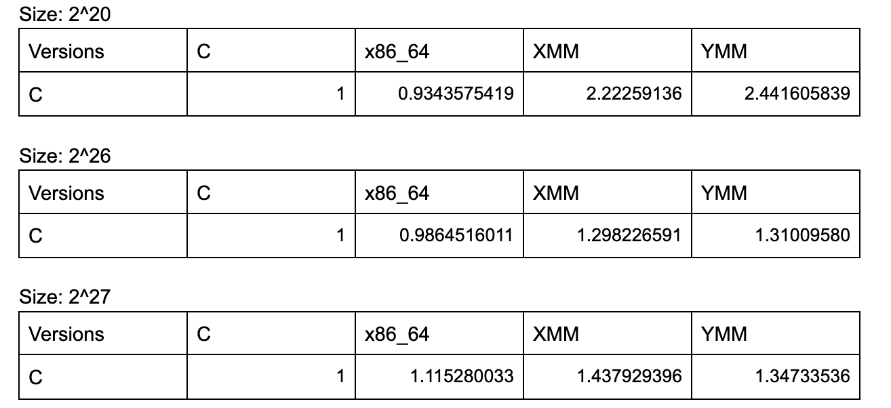
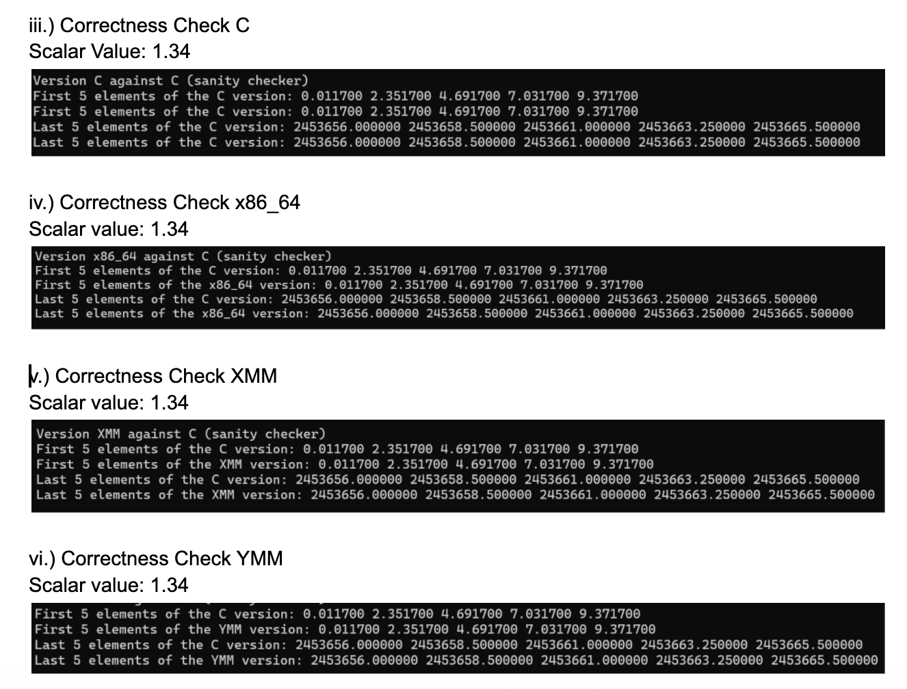

# simd-vector-programming
Members: Bactong, Gunita, Panganiban, Lobo

---
### i) Screenshot of  program output with execution time for all cases

Figure 1. Program output for case 2^20

---

Figure 2. Program output for case 2^26

---

Figure 3. Program output for case 2^29

### ii) Comparative Table

Figure 3. Comparitive Table of execution time, correctness, and boundary checks

#### ii.a) Speedup comparisons of versions against C

Based on the speedup comparison results against the C version. It can be said that XMM and YMM constantly out performs the C version due to its ability to parallel compute. The concept of parallelism in XMM and YMM allows each version to perform the AXPY calculation by handling 4 and 8 floats at a time, respectively. However, for the x86_64 version, it can be seen that C out performs its execution time when size is 2^20 and 2^26. This is due to its nature to calculate an operation 1 float at a time. Nevertheless, as the size continues to grow, such as when 2^27, it out performs C by 1.12x. As such it can be said that x86_64 will out perform C when handling size in extreme cases. 

### iii) Correctness checks

### vii) Boundary Check

### viii) Analysis and Discussion
The performance of the C, x86-64 assembly, XMM, and YMM implementations were evaluated using different vector sizes of 2 to the power of 20, 2 to the power of 26, and 2 to the power of 29 elements. Each implementation was timed to compare its execution time when processing different amounts of data.

The C implementation served as the baseline for comparison, while the x86-64 assembly implementation used scalar instructions and XMM and YMM implementations used SIMD instructions to process multiple elements simultaneously. XMM processes four single-precision FP elements per 128-bit vector, while the YMM processes eight elements per 256-bit vector. These wider vector operations can improve performance by reducing the number of instructions needed to process the same amount of data.

As the vector size increases, the execution time is expected to increase because more elements need to be processed. To counter this, SIMD programming can cut the execution time by processing multiple operations in parallel. We observe this in the comparative table wherein the average time taken by the XMM and YMM kernels are significantly faster than the C and x86-64 kernels. To further explain, XMM registers are 128-bit wide and YMM registers are 256-bit wide, and can fit 4 single-precision floats and 8-single-precision floats, respectively. Using the AVX2 ISA, we are able to process the floats stored in SIMD registers at the same time, decreasing the time to go through all elements in the vector.  Meanwhile, the x86-64 kernel seems to be slower than the C kernel. This is because the x86-64 loop processes one element at a time, closely matching the execution time of the C compiler. 

Additionally, performance depends on factors such as instruction efficiency, memory access, processor architecture, and overhead of handling remaining elements that could not be processed in complete vector groups, which may affect execution time. 

### ix. problems encountered and solutions made
1. Machine Compatibility Issues
Problem: the program did not run consistently across different machines/computer. In particular, the program running on MacOS would crash before completing execution
Solution: We reviewed and adjusted some parts of the code where the crash starts, addressing the issues encountered when running the program on different machines

2. YMM Boundary Checking
Problem: The initial YMM implementation did not have a boundary checker to handle the elements that could not be processed in complete vector-sized groups.The starting position and handling of boundary elements were also incorrect. Solution: We added a boundary-checking mechanism to handle the remaining elements that could not be processed by the main vector loop.

